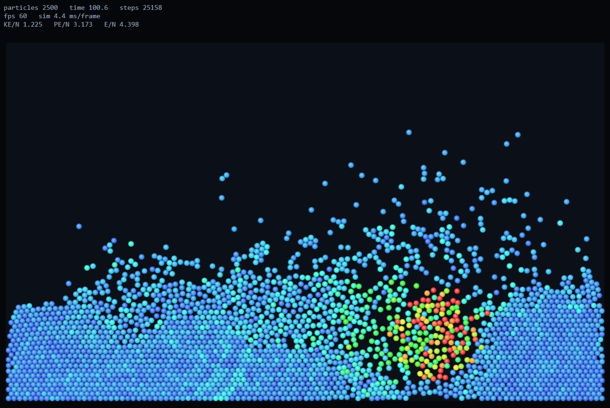

# particlesim

A 2D molecular dynamics simulator written in Go with a browser visualizer. It uses only the standard library and needs Go 1.22 or later.

Run `go test ./...` to check the physics, then `go run .` and open http://127.0.0.1:8080. The server binds to loopback only. Flags are `-n` (particle count, up to 4000), `-preset` (drop, crystal, collision or gas), `-seed` and `-addr`. To get a standalone binary, use `go build -o particlesim .`.

The engine in `sim/` integrates Lennard-Jones particles with velocity Verlet and a cell list, with reflecting walls, gravity, optional drag, an optional Berendsen thermostat that acts on motion relative to the centre of mass, and a mouse force. Drag in the browser to attract particles, right drag or shift drag to repel. The tests compare the cell list against brute force pair sums, check energy conservation with the thermostat off, and check that the thermostat settles at its target temperature.

The browser polls `/frame` for a compact binary snapshot (header plus x, y and speed per particle), so rendering never drives the physics. Settings go through `POST /params`, restarts through `POST /reset`, and the mouse through `POST /pointer`.

